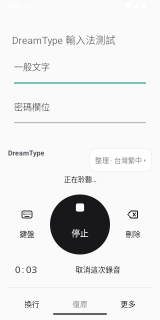
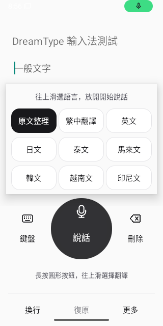
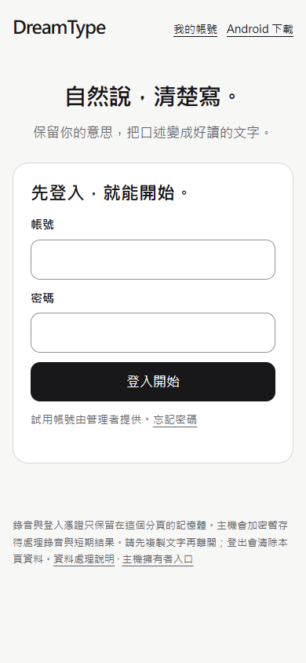

# 台灣中文語音輸入介面更新

## 使用流程

首次安裝以「帳號 → 麥克風 → 鍵盤」引導，服務網址已有預設，登入只需先填帳號與密碼，進階網址設定可再展開。進入鍵盤後，大圓鈕負責說話、停止、插入；旁邊是切換鍵盤與退格。底部固定換行、復原、更多，不能復原時保留位置並停用，避免控制項突然換位。計時與取消共用固定高度區域，錄音前後主按鈕位置不變。

錄音時顯示計時與「取消這次錄音」，取消不送出音訊。長按大圓鈕往上滑可選翻譯語言並開始說話；直接點上方模式則只更換輸出方式，讓不方便使用手勢的人也能選語言。整理仍只整理口述，不代為執行口述指令。

個人設定把返回放在上方、儲存固定在下方，長詞庫也不必滑到底才能儲存。網頁沿用黑白、單一主按鈕與清楚的結果區；手機結果出現後移至預覽，桌面則並排錄音與文字。未設定 Google 登入時不顯示無法使用的入口。

## 視覺與互動規則

- 使用系統繁中文字體；主要文字 #18181B、次要文字 #52525B、背景 #FAFAFA。
- Android 觸控區至少 48dp；網頁主要操作至少 48px；圖示另附文字與無障礙名稱。
- 圓形錄音與停止共用位置，使用本地向量圖示，避免不同手機的 emoji 外觀差異。
- 錄音、處理、預覽、失敗均有文字狀態；網頁遵守減少動態效果設定。
- 不以顏色單獨表示狀態，不以成功綠色提示代替下一步。
- 不顯示尚未設定好的登入方式，也不把封閉測試包描述為商店正式版。

## 驗證範圍

瀏覽器檢查使用真實 Chromium、合成麥克風與隔離 API，涵蓋上傳失敗重試、回執失敗、還原原文、復原、取消、登出與手機寬度。Google UI 檢查使用測試 SDK，不能視為真實 Google 帳號驗收。固定 HTTPS 網站另驗證未登入畫面、可載入的模組、手機無橫向溢出及未啟用登入入口隱藏。

Android 模擬器會實際點擊錄音／取消／翻譯／插入／復原，檢查設定儲存位置，另以 1.3 倍系統字體檢查鍵盤控制項。自動點擊等待畫面座標穩定，避免 IME 高度切換時點到佈局更新前的位置；仍要求取消後回到待機。

Pixel 9、TalkBack、Surfshark 行動網路及真實更新安裝仍需使用者實機驗收。這次 UI 部署不遷移資料庫、不啟用付款；家用主機仍須在線。

## 實際畫面

前兩張為 Android 16 模擬器測試畫面，第三張為正式網站未登入頁；不是設計稿，也不是 Pixel 9 實機證據。

| 錄音與取消 | 長按上滑翻譯 | 手機網頁登入 |
|---|---|---|
|  |  |  |
